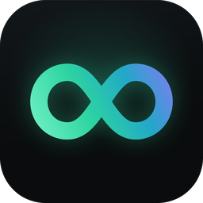
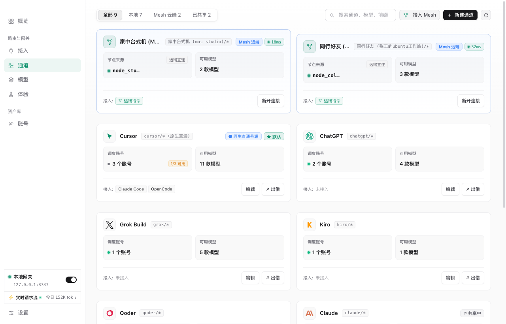
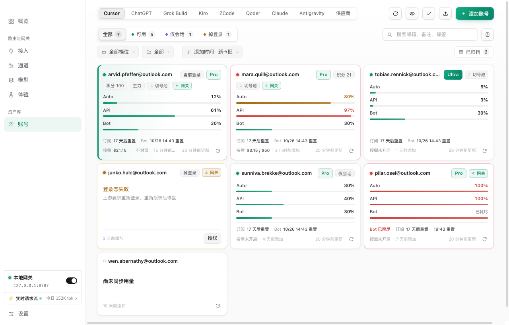
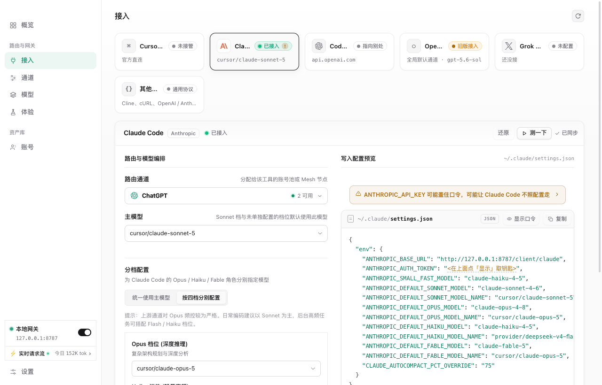

<div align="center">



# Nexus

**一站式本地 AI 聚合网关与去中心化号池调度中枢**

将你拥有的各类 AI 订阅号与 API 供应商，聚合为本机标准的 OpenAI 与 Anthropic 兼容端点。

[](https://github.com/roviix/nexus/releases)
[](https://github.com/roviix/nexus/actions/workflows/ci.yml)
[](./LICENSE)


[**📥 立即下载最新版**](https://github.com/roviix/nexus/releases/latest) · **中文** · [English](./README.en.md)

<br/>

<a href="https://github.com/roviix/nexus/releases/latest">
  
</a>

</div>

---

## 💡 为什么你需要 Nexus？

如果你在日常开发中使用 **Claude Code**、**Cursor**、**Codex CLI** 或各类 AI 客户端，你一定遇到过这些痛点：

- 💸 **API Key 昂贵且容易风控**：明明手头有 ChatGPT Plus、Claude Pro、Kiro 等网页端/官方订阅，却无法直接在本地 CLI 工具中使用；
- 🛑 **单账号额度频繁受限 (Rate Limit / 429)**：写代码到关键时刻遇到额度耗尽，不得不停下工作手动换号，极大打断心流；
- ⚙️ **客户端配置极其繁琐**：每个 CLI 工具的配置文件位置、格式（JSON / TOML / 环境变量）各不相同，修改稍有不慎就导致报错；
- 🌐 **跨设备与好友共享困难**：想把公司电脑或空闲的账号额度借给家里电脑或团队伙伴，却受限于局域网和繁琐的代理设置。

👉 **Nexus 为解决这些问题而生**。它在你本地启动一个标准 OpenAI / Anthropic 兼容网关，把多个账号聚合为一个超级管道，自动接力轮转，还支持端端加密的去中心化 P2P 共享（Mesh）。

---

## ✨ 核心特性

### 1. 🔀 统一双协议网关 (Unified Gateway)
一个本地端口（默认 `8787`），同时转译 **OpenAI**（`/v1/chat/completions`）与 **Anthropic**（`/v1/messages`）两种协议标准。支持流式打字机 SSE 输出、Thinking 深度思考 Tokens、Prompt 缓存与 Tool Calls。

### 2. 🔄 智能号池与额度无感接力 (Quota Auto-Relay)
支持多平台多账号统一调度。当某个账号额度耗尽或遭遇限流时，Nexus 自动切入同一渠道的下一个可用账号，告别手动换号；长会话自动保持账号粘性，保障上下文连贯。

<div align="center">
  
</div>

### 3. 🌐 Nexus Mesh 去中心化对等共享 (P2P Mesh Network)
通过端端加密反向隧道，一键将本地多余通道“出借”给自己的多台设备（如家庭台式机）或团队好友。
- **极简配对**：勾选想要共享的模型通道，一键生成 6 位动态配对码（如 `NX-882190`），远端设备输入即可瞬间建立直连；
- **零网络门槛**：无需公网 IP，无需配置复杂的内网穿透与路由器端口映射，局域网走超低延迟直接互通，跨公网自动建立端到端加密穿透隧道；
- **本地所有者保护 (Preemption)**：本地发起请求时自动启动抢占保护机制，永远优先保障本机使用体验，外部分享绝不卡顿。

### 4. ⚡ 客户端一键无损接入 (One-Click Client Injection)
告别繁琐的手动编辑配置文件。Nexus 深度适配主流开发工具，改动前自动创建完整快照备份，随时一键还原：
- **Claude Code**：自动配置 `~/.claude/settings.json`，跳过登录引导，支持 Sonnet / Opus / Haiku / Fable 四档分流；
- **Codex CLI**：自动写入 `~/.codex/config.toml`；
- **OpenCode** / **Grok CLI** / **Cursor IDE** 等开箱即用。

<div align="center">
  
</div>

### 5. 🔒 100% 本地优先与隐私安全 (Local-First)
所有账号凭据、Token、请求日志与配置均严格保存在你本地的 SQLite 数据库中。**没有中心服务器、没有云端账户、零数据遥测**，你的任何敏感代码与会话记录绝不经过第三方服务器。

---

## 🧩 支持渠道与客户端生态

| 支持的上游账号 / 平台 | 接入方式 | 适用场景与能力 |
| :--- | :--- | :--- |
| **ChatGPT** | OAuth 浏览器授权 / Session 导入 | 原生 Codex CLI 接入，支持 o1 / o3 / gpt-5 等全系模型 |
| **Claude** | 网页 OAuth 授权 / 凭据导入 | 完整 Anthropic Messages 协议，支持 Thinking 思考流式输出 |
| **Kiro** | AWS SSO 授权 / CLI Token 导入 | 聚合全系主流顶级编程模型，极高稳定性与并发能力 |
| **Grok** | xAI 账号授权 / Refresh Token | 原生支持超长上下文窗口与深度推理分析 |
| **智谱 ZCode** | 自动提取官方客户端凭证 / API Key | 智谱 GLM 编程专项模型，国内直连低延迟 |
| **Qoder** | PAT 个人访问令牌导入 | 区分国际版与国内版独立高速专线 |
| **Google Antigravity** | 授权凭证对接 | Google 反重力开发系列模型调度 |
| **API 供应商 (Provider)** | 填入 Base URL + API Key | 支持 DeepSeek、Kimi、OpenRouter、硅基流动等任意兼容地址 |

**支持连接的下游**：Claude Code CLI、Codex CLI、OpenCode、Cursor、Chatbox、NextChat、官方 Python/Node.js SDK 及任意支持自定义 Base URL 的应用。

---

## 🚀 3 步快速上手

### 第 1 步：下载并安装
前往 [GitHub Releases](https://github.com/roviix/nexus/releases/latest) 下载适合你系统的安装包：
- **macOS**：下载 `.dmg` 并拖入 Applications（原生支持 Apple Silicon 与 Intel 芯片）
- **Windows**：下载 `.exe` 安装程序一键安装

### 第 2 步：绑定账号
启动 Nexus，在 **「账号」** 页面点击对应平台卡片，通过浏览器一键登录或粘贴 Token 导入。

### 第 3 步：一键连接客户端
在 **「接入」** 页面找到你正在使用的客户端（如 Claude Code），点击 **「一键接入」**。打开你的终端，直接尽情写代码！

你也可以通过任何标准 HTTP 客户端直接调用本机网关：

```bash
curl http://127.0.0.1:8787/v1/chat/completions \
  -H "Authorization: Bearer $NEXUS_GATEWAY_TOKEN" \
  -H "Content-Type: application/json" \
  -d '{
    "model": "kiro/claude-sonnet-4.5",
    "messages": [{"role": "user", "content": "你好，Nexus！"}]
  }'
```

---

<details>
<summary>🛠️ 开发者指南：源码构建与架构文档（点击展开）</summary>

### 环境要求
- **Node.js** >= 20
- **Rust** stable (推荐通过 `rustup` 安装)
- **Tauri v2** 开发环境要求（详见 [Tauri Prerequisites](https://v2.tauri.app/start/prerequisites/)）

### 本地运行与打包
```bash
# 克隆仓库
git clone https://github.com/roviix/nexus.git
cd nexus/apps/desktop

# 安装依赖并启动本地开发 (含热重载)
npm ci
npm run dev

# 打包当前平台安装包
npm run tauri build
```

### 仓库架构
```
nexus/
├── Cargo.toml                  # Workspace 配置
├── crates/
│   ├── nexus-core/             # 领域实体、全局错误与时间工具
│   ├── nexus-store/            # 本地 SQLite 存储、凭证加密与状态迁移
│   ├── nexus-gateway/          # 本地统一网关服务、协议转译与路由分流
│   ├── nexus-mesh/             # 去中心化 P2P 共享网络与反向加密隧道
│   ├── nexus-connect/          # 客户端配置读写、自动注入与快照备份
│   ├── nexus-accounts/         # 账号池调度逻辑、额度计算与生命周期管理
│   └── nexus-*/                # 各平台适配驱动 (chatgpt, claude, kiro, grok, zcode, qoder...)
├── apps/desktop/               # Tauri v2 + React 桌面客户端源码
└── docs/                       # 架构设计深入文档 (ARCHITECTURE.md, MESH.md)
```

</details>

---

## 💬 AI 探索与交流 (AI Sharing & Community)

欢迎加入我们的 AI 探索与技术交流群，围绕大模型应用落地、Claude Code / Cursor 实战心得、AI 前沿分享与工程经验进行自由探讨！

<div align="center">
  
  <p style="margin-top: 10px; font-size: 13.5px; color: #555;">
    微信扫码添加好友（微信号：<code>ouyzam</code>，昵称：<code>ouyz</code>），备注 <strong>AI 交流</strong> 或 <strong>Nexus</strong> 即可受邀进群。
  </p>
</div>

---

## ⚠️ 免责声明 (Disclaimer)

- Nexus 仅供个人合法学习、研究与个人多设备统一工作流调度使用。
- 本工具通过调用用户自身具备合法授权的账户会话或开放客户端接口对外供能。用户需严格遵守相关平台的服务条款（Terms of Service），请勿将其用于高频滥用或未经授权的商业转售。
- 本项目与 OpenAI、Anthropic、Cursor、xAI、AWS 等公司无任何商业隶属或背书关系。
- 软件基于 MIT 许可证按“现状”分发，作者不对使用过程中产生的账号状态变动或任何直接/间接损失承担责任。

---

## 📄 开源协议

本项目采用 [MIT 许可证](./LICENSE) 开源。欢迎提交 Issue 与 Star 支持！
