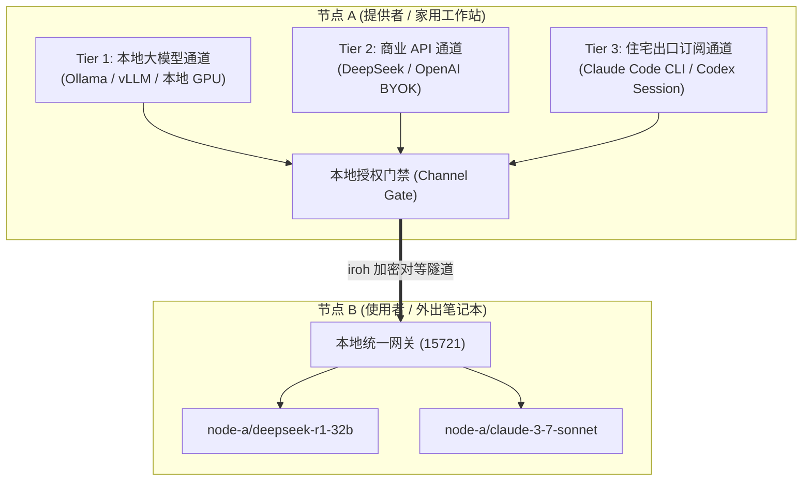
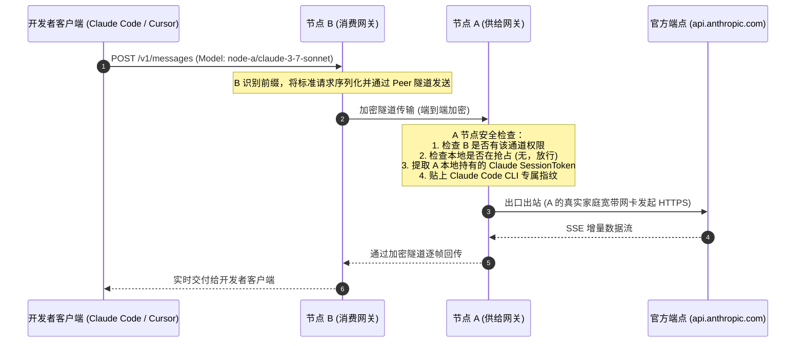

# Nexus Mesh · 极简对等网络、住宅出口与通道共享协议规范 (RFC-001)

> **文档版本**：RFC-001 (Streamlined Final 5.0)  
> **定位**：工程规范与技术实施标准（无过度设计、无大厂合规官僚病、完全自包含）。  
> **核心哲学**：**以 Local-First 为根基，以已有 Channel 为粒度，以 P2P 隧道为纽带，让开发者的闲置宽带与模型通道自由互联。**  
> **编写日期**：2026-10-10  

---

## 目录

1. [一页纸看懂 Nexus Mesh](#1-一页纸看懂-nexus-mesh)
2. [Nexus 现有资产与架构基线](#2-nexus-现有资产与架构基线)
3. [为什么不做复杂的企业 Mesh？——设计去伪存真](#3-为什么不做复杂的企业-mesh设计去伪存真)
4. [核心拓扑：Nexus Peer Link 对等隧道与传输技术选型](#4-核心拓扑nexus-peer-link-对等隧道与传输技术选型)
5. [权限解耦：设备配对 (Pairing) ≠ 通道授权 (Authorization)](#5-权限解耦设备配对-pairing--通道授权-authorization)
6. [共享粒度：直接复用已有 Channel（三层能力矩阵）](#6-共享粒度直接复用已有-channel三层能力矩阵)
7. [端到端请求流与真实信任边界](#7-端到端请求流与真实信任边界)
8. [物理级安全硬化：固定端点阻断 SSRF](#8-物理级安全硬化固定端点阻断-ssrf)
9. [本地所有者霸权抢占与三级故障自愈模型](#9-本地所有者霸权抢占与三级故障自愈模型)
10. [端到端用户体验与界面交互](#10-端到端用户体验与界面交互)
11. [极客互惠机制与演进路线](#11-极客互惠机制与演进路线)

---

## 1. 一页纸看懂 Nexus Mesh

### 1.1 它解决什么问题？
* **痛点 A（住宅 IP 与防风控）**：Anthropic 和 OpenAI 对数据中心（机房）IP 的自动化调用风控极严（极易触发验证码质询甚至连坐封号），而真实家庭宽带（Residential ISP）拥有天然的高信誉度。
* **痛点 B（闲置订阅浪费）**：很多开发者自费订阅了 Claude Pro 或 ChatGPT Plus，但 5 小时 45 条的额度日常只能用掉 20%~30%，剩下的白白浪费。
* **痛点 C（多设备与远程调用）**：开发者在外用笔记本，想调用家里台式机的住宅网络或本地运行的大显存模型（如 Ollama DeepSeek 32B），但配置繁琐。

### 1.2 它怎么解决？（一句话）
**用一个 6 位配对码将两台 Nexus 连成加密隧道，允许一台机器把本机的某个 AI 通道（Claude Pro / ChatGPT / 本地模型）开放给另一台机器调用。**

```text
┌────────────────────────────────┐         端到端加密对等隧道        ┌────────────────────────────────┐
│   节点 B (使用者 / 外出本)       │ ◄==============================► │   节点 A (提供者 / 家中台式机)   │
│                                │      (QUIC 直连或 DERP 盲中继)   │                                │
│ • 本地网关: 127.0.0.1:15721    │                                 │ • 本地网关: 127.0.0.1:15721    │
│ • IDE 调: node-a/claude-3-7    │                                 │ • 开启共享: Channel "claude"   │
│ • 请求送入加密隧道               │                                 │ • 家宽网卡直连 api.anthropic  │
└────────────────────────────────┘                                 └────────────────────────────────┘
```

---

## 2. Nexus 现有资产与架构基线

Nexus 绝不是空中楼阁，Mesh 完全建立在 Nexus 现有的扎实资产之上：

1. **单进程桌面客户端 (`apps/desktop`)**：
   * 基于 Tauri v2 + 纯 Rust Tokio 运行时 + React 19 / TypeScript / Vite；
   * 零云端依赖（Zero-Cloud）、零遥测（Zero-Telemetry），账号数据库与密钥完全保存在本地 SQLite。
2. **本地统一兼容网关 (`crates/nexus-gateway`)**：
   * 本机监听 `127.0.0.1:15721`；
   * 自动在 OpenAI (`/v1/chat/completions`)、Anthropic (`/v1/messages`) 与 Responses 协议之间做双向转换，支持逐帧流式（SSE）、Prompt Caching 与 Thinking 签名。
3. **已深度逆向的成熟通道 (`crates/nexus-*`)**：
   * **`claude`**：完整逆向 Claude Code CLI 指纹，支持 OAuth / setup-token，直连 `api.anthropic.com`；
   * **`chatgpt`**：直连官方 Codex CLI 接口，逐帧透传 reasoning 凭据与 compaction；
   * **`antigravity`**：逆向 Google Cloud 开发者伴侣协议，独立双 5h 额度重置；
   * **`kiro`**：AWS Bedrock 企业级通道；
   * **本地模型**：支持直连本机或局域网 Ollama / vLLM。

---

## 3. 为什么不做复杂的企业 Mesh？——设计去伪存真

市面上部分分析报告倾向于把系统复杂化（建议搞“个人 Mesh + 团队 Mesh + 开放算力 Mesh”，引入 UCAN 令牌衰减、RBAC 组织树、哈希链审计、企业 SSO、TEE 机密计算等）。

**Nexus 明确拒绝这种过度设计，原因极其深刻：**
1. **违背独立极客定位**：Nexus 是开发者的个人效能神器。如果强行去做团队审批流、权限审计，就沦为了平庸的 LiteLLM 企业版复刻品，彻底丢掉了核心敏捷性。
2. **避免伪“零知识”自相矛盾**：如果引入中心化 Broker 在内存中解密请求并持有两方 Token，所谓的“零知识”就变成了自欺欺人的商业中转站。
3. **回归最坚固的网络本质**：不管是自己的两台电脑互通，还是朋友之间借用算力，在网络层本质上**完全是一回事**——**安全对等隧道（Peer-to-Peer Link）**。唯一的区别只是配对码发给了谁！

---

## 4. 核心拓扑：Nexus Peer Link 对等隧道与传输技术选型

### 4.1 节点身份 (Node Identity)
每个 Nexus 实例在首次启动时，生成唯一的 **Ed25519 密钥对**：
* `NodeId`：公钥的派生哈希（如 `node_7f3b89e2`）；
* 设备间互信完全基于公钥验签，不依赖任何中心化账号体系。

### 4.2 极简配对（Pairing Flow）
两台设备如何建立连接？
1. 节点 A 点击「生成连接码」，界面显示：`NX-8839`（有效期 10 分钟，关联节点 A 的公钥与打洞候选信息）；
2. 节点 B 输入 `NX-8839`，双向交换公钥并保存至各自本地的“受信任节点表”；
3. 配对完成，节点间建立加密链路。

```mermaid
sequenceDiagram
    autonumber
    participant A as 节点 A (提供者 / 家中主机)
    participant Relay as 公共/自建轻量盲中继 (DERP)
    participant B as 节点 B (使用者 / 外出本)

    Note over A: 1. A 生成临时配对码 NX-8839<br/>(挂载 A 公钥与打洞候选)
    B->>A: 2. B 输入 NX-8839，发起双向公钥交换
    Note over A,B: 3. 双方在本地持久化对方 NodeId 与公钥
    
    rect rgba(16, 185, 129, 0.1)
    Note over A,B: 4. 建立数据通道 (QUIC / 双向加密)
    alt NAT 能够打洞 (80% 场景)
        B<->>A: UDP 直接打洞直连
    else 对称型 NAT 打不通
        B<->>Relay: 建立 TLS 隧道
        A<->>Relay: 建立 TLS 隧道
        Note over Relay: Relay 仅作为盲转发器 (纯转发密文，无私钥，绝无明文)
        B<--Relay-->A: 端到端密文穿透
    end
    end
```

### 4.3 P2P 网络底层选型对比：为什么选 `iroh`？

在 Rust 生态中，针对对等连接技术的深入横向选型对比：

| 选型方案 | 协议与底层基础 | 优势 | 劣势与评价 |
| :--- | :--- | :--- | :--- |
| **DoH**<br>(DNS-over-HTTPS) | RFC 8484 (443 端口加密 DNS) | 仅用于防范 ISP 的 DNS 污染与嗅探 | **根本不是 P2P 隧道**。它只负责查域名对应 IP，完全不具备穿透与数据流传输能力。 |
| **`iroh`**<br>(**官方首选推荐**) | Rust 原生、基于 **QUIC (quinn)**、内置 DERP 式加密中继与 STUN 打洞 | • 纯 Rust，无系统内核依赖<br>• 应用层非 root 权限运行<br>• 内置 Ed25519 节点身份与加密<br>• 直连与中继无缝自动回落 | **最契合 Nexus 现状**。轻量、现代、零历史包袱，专为 Local-First 应用打造。 |
| **`libp2p`** | IPFS / 以太坊生态底层 | 成熟、生态庞大 | **极度笨重**。抽象层级过多（Swarm/Transport/Muxer），依赖大量冗余 Crate，学习维护成本极高。 |
| **`webrtc-rs`** | WebRTC 数据通道 (SCTP/DTLS) | 跨浏览器友好 | 信令交换协议（SDP/ICE）过于繁琐，在非浏览器桌面应用中多此一举。 |
| **WireGuard / TUN** | 内核/用户态 VPN 网卡 | 吞吐量极高 | 需要创建虚拟网卡（TUN/TAP），必须获取管理员/Root 权限，会破坏 Nexus 绿色便携免提权的体验。 |

**结论**：Nexus Mesh 推荐以 **`iroh`**（或其 underlying `quinn` + DERP）作为 Rust 核心的网络基础设施。

---

## 5. 权限解耦：设备配对 (Pairing) ≠ 通道授权 (Authorization)

**连接确定“这是谁的设备”；授权确定“这台设备能调用哪个 Channel”。**

即使配对成功，节点 B 也不会默认获得节点 A 的所有通道访问权。节点 A 在本地配置一条极简授权规则：

```text
[已配对设备: MacBook-Pro-16 (node_7f3b89e2)]
  ├── 允许调用的通道: [✓] claude   [✓] ollama   [ ] chatgpt
  ├── 最大并发限制:   1 并发
  ├── 本地额度保护:   保留自身 40% 额度
  └── 状态与撤销:     [一键暂停] [永久解除配对]
```

* **无中心认证**：无需云端 RBAC 或复杂组织树，仅在提供者本地 SQLite 记录一条绑定规则；
* **即时生效与撤销**：提供者随时可以一键关闭某个通道或解除设备配对，下一次请求立即被本地网关拒绝。

---

## 6. 共享粒度：直接复用已有 Channel（三层能力矩阵）

Nexus Mesh 拒绝“单押消费订阅”的脆弱定位，而是将所有模型能力抽象为**三层立体通道**：



1. **Tier 1: 本地 GPU 模型通道 (`ollama` / `vllm`)**：
   * 在外出差时，用笔记本通过 Mesh 调用家里 4090 / Mac Studio 上的本地大模型，完全不受平台条款与费用限制；
2. **Tier 2: 商业 API 通道 (`provider` / BYOK)**：
   * 将公司或家庭统一配置的商业 Key 作为受控接口开放给备用设备，Key 绝不离开主机；
3. **Tier 3: 住宅出口订阅通道 (`claude` / `chatgpt`)**：
   * 极客杀手级功能。利用家庭宽带网卡代为出站，规避机房 IP 连坐封锁，盘活闲置额度。

---

## 7. 端到端请求流与真实信任边界

诚实的工程设计必须明确说明数据流经哪里、谁能看到什么：



### 真实信任模型（透明披露）：
1. **配对双方天然互信**：
   * 节点 A 能看到通过其出口调用的 Prompt 明文（因为 A 需要为请求组装上游报文）；
   * **这是对等网络的物理本质**：这套方案最适合**“自己的多台设备（MacBook 连家里台式机）”**或**“熟人/朋友之间互助”**；
   * 在熟人与自有设备场景下，不需要伪装复杂的“假零知识”，信任是真实、直接且高效的。
2. **提供者 Token 绝对不出域**：
   * 节点 A 的 Claude / ChatGPT 真实 Token **从始至终只躺在 A 的本地 SQLite 中**，绝对不会通过隧道发送给 B；
   * B 即使嗅探所有数据包，也只能拿到模型推理的结果，绝不可能偷走 A 的账号资产。
3. **物理出口原生防封**：
   * 对 Anthropic/OpenAI 来说，TLS 连接的物理源 IP、TCP SYN 握手、RTT 延迟完全来自 A 的家庭宽带网卡，有效规避数据中心机房 IP 的连坐封杀。

---

## 8. 物理级安全硬化：固定端点阻断 SSRF

传统代理最大的漏洞是允许客户端传递任意目标 URL，从而导致内网被扫描（SSRF）。

**Nexus Mesh 在架构上直接废除此能力，实现绝对物理免疫：**

1. **远端无权指定出站目标**：
   * 节点 B 的请求体里**只有 `channel_id`（如 `claude`）和请求内容**，根本没有 `url`、`host` 或 `ip` 字段；
   * 出站的目标端点（如 `https://api.anthropic.com` 或 `http://127.0.0.1:11434`）完全由节点 A 本地该 Channel 的配置硬编码锁死；
   * 节点 B 在物理上没有任何手段让节点 A 去扫描内网 NAS、路由器或未授权接口！
2. **本地模型端点的精准隔离**：
   * 当节点 A 开放本地 `Ollama` 时，本地网关仅映射其推理端口（如 `/api/chat`），严格拦截管理、拉取、删除模型等敏感运维路径。

---

## 9. 本地所有者霸权抢占与三级故障自愈模型

### 9.1 本地优先霸权抢占 SLO (Preemption Invariant)
* **核心原则**：电脑是 A 自己的，A 在本机打代码时必须拥有最高优先级，外部共享请求绝不能让本地感受到丝毫卡顿。
* **抢占指标**：
  * 只要 A 在本机 IDE 发起请求，调度器在 **$P_{99} < 50\text{ms}$** 内向外部隧道发送限速/中止信号；
  * 外部连接被优雅挂起或切断，家庭宽带上行与上游并发连接立即全额还给 A；
  * A 桌面端状态栏亮起呼吸黄灯：`【本地优先保护中 · 外部共享已主动避让】`。

### 9.2 三级故障自愈机制
不给用户画“所有故障 500ms 盲目重放”的虚幻大饼（因为带 Tool Call 的 Agent 请求盲目重放会导致重复下单、重复删库等严重副作用）：

1. **Level 1 (网络瞬断重连)**：
   * 隧道短暂闪断但执行进程未死，通过 SSE 消息序号自动补漏重传，客户端无感；
2. **Level 2 (前置故障重选)**：
   * 发出请求的前 500ms 内（首个 Token 尚未生成、未产生任何副作用）节点 A 突然断电或合盖，节点 B 自动切换到备用节点重发；
3. **Level 3 (中途断流提示)**：
   * 生成到一半时断开，或已发生外部工具调用，**明确向客户端报错并提供“从断点续写”按钮**，杜绝产生外部破坏性副作用。

---

## 10. 端到端用户体验与界面交互

### 10.1 使用者极简体验 (30秒上手)

#### 场景 A：终端直接跑 Claude Code
```bash
# 指向本地 Nexus 网关
export ANTHROPIC_BASE_URL="http://127.0.0.1:15721"
export ANTHROPIC_API_KEY="nexus-mesh"

# 跑远程节点的 Claude 3.7
claude --model node-a/claude-3-7-sonnet
```

#### 场景 B：Cursor / VS Code Cline
* **Base URL**: `http://127.0.0.1:15721/v1`
* **API Key**: `nexus-mesh`
* **Model**: `node-a/claude-3-7-sonnet`

---

## 11. 极客互惠机制与演进路线

### 11.1 互惠机制：简单的对等记账 (Peer Karma)
* 不发行花哨的中心化虚拟币，不引入复杂的金融合规风险；
* 采用本地追加账本：记录“节点 A 帮我转了多少 Token，我帮节点 A 转了多少 Token”；
* 朋友与圈子之间自由对等互换（例如：你帮我出 Claude 算力，我帮你出本地 GPU 算力）。

### 11.2 极简工程路线图

| 阶段 | 核心交付 | 验证标准 |
| :--- | :--- | :--- |
| **P0: 通道级共享开关** | 在已有 Channel 卡片上增加共享控制与并发限制抽屉 | 前端 Vitest 387 项用例全绿 (已就绪) |
| **P1: 双机配对与隧道** | 6 位码配对，基于 `iroh` 的 QUIC 直连打洞与轻量 DERP 密文盲中继 | 跨公网两台电脑通过 `node-a/channel` 调通推理 |
| **P2: 抢占与防 SSRF** | 本地抢占 50ms 避让与固定端点执行 | 本地发请求外部立即退避；远端无权注入任意 URL |
| **P3: 对等互惠账本** | 统计双方双向互换的 Token 用量与质量指标 | 本地账本清晰记录双向贡献 |

---
*(End of Streamlined RFC-001 Revision 5.0)*
